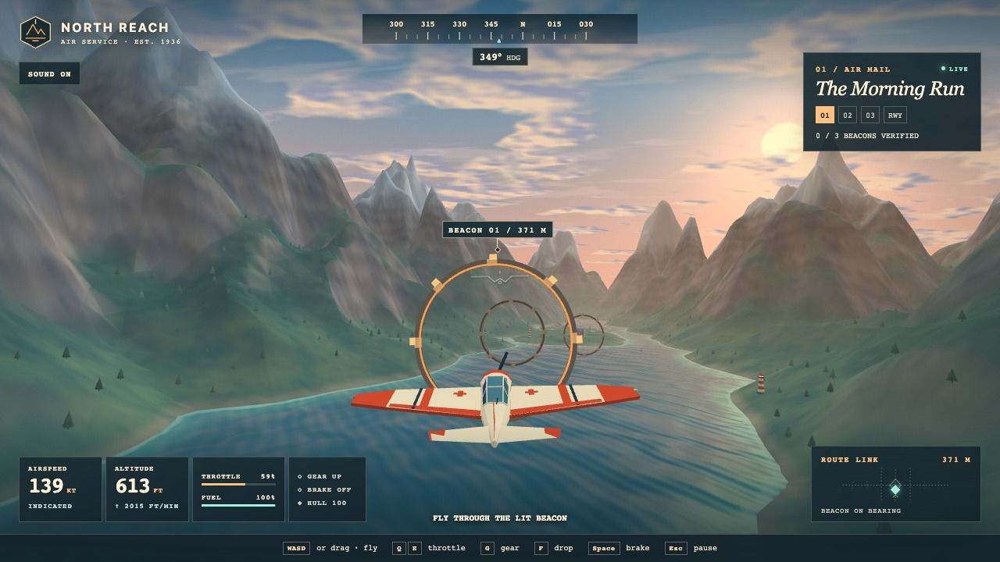

# Signal Fjord

[](https://make.fun/bounty/best-flight-game-20261126-0057?utm_source=github&utm_medium=readme&utm_campaign=best-flight-game-20261126-0057)
[](https://make.fun/bounty/best-flight-game-20261126-0057/leaderboard?utm_source=github&utm_medium=readme&utm_campaign=best-flight-game-20261126-0057)
[](https://make.fun/bounty/best-flight-game-20261126-0057?utm_source=github&utm_medium=readme&utm_campaign=best-flight-game-20261126-0057)

**Below the snow line. Above the tide.** Fly a radial-engined Kestrel out of the North Reach as the sun comes over the fjord. This is an original, offline arcade flight sim with a procedural WebGL 2 landscape, a keyboard/mouse flight model and synthesized cockpit audio.



## Run it

From the repository root, serve the game and open **http://127.0.0.1:8080/** in desktop Chrome. Enable hardware acceleration if WebGL 2 is unavailable. No packages, build, account or Internet access needed.

```sh
python3 -m http.server 8080 --bind 127.0.0.1 --directory game
```

| Dispatch | What to do |
| --- | --- |
| **The Morning Run** | Fly through the three amber rings in order, take the blue approach gate, and land on Runway 01. |
| **The Low Drop** | Slow down for the two relief corridors. Press **F** when the drop ring turns green; then land on 01. |
| **The Wind Trace** | Cross all four survey gates in 52 seconds in a gustier fjord. No landing needed. Full power burns through the small fuel load. |

### Pilot's notes

- **W/S** or **↑/↓** pitch; **A/D** or **←/→** bank. Or hold the left mouse button on the view and drag: the farther from the press, the more input. Release to center. **Esc** pauses and offers pitch inversion; **M** toggles sound.
- **Q/E** lower/raise throttle. **G** extends the gear. **Space** is an air/wheel brake; don't hold it throughout final. Both the aircraft and the instruments respond to bank, power, wind and stall speed.
- Center up early. The glowing gate and scope mark the current leg. Missed a beacon? Loop back and cross it from the south. In The Low Drop, the marker turns green only inside the release corridor and below its speed limit.
- At the blue approach gate, lower gear and set up for **85–130 kt**. Center the glide diamond and runway stripe. Near the threshold, level the wings and raise the nose gently before contact. Once the wheels touch, idle the throttle and hold **Space** until stopped.
- Score rewards centered passes and a clean landing. In the final report use **Fly again** to retry, or **All dispatches** to switch routes.

## Files and entry output

`flight.js` runs the aircraft and mission states; `world.js` defines the fjord and dispatches. `geometry.js`, `scenery.js`, `airframe.js` and `atmosphere.js` build the original 3D scene. `camera.js`, `renderer.js`, `input.js`, `instruments.js` and `sound.js` handle the chase camera, drawing, controls, avionics and sound. There's no external asset or runtime dependency.

Node **22.18+** generates the judging files with the official kit library at `vendor/makefun-game.ts`. Give each run an empty output directory:

```sh
mkdir -p /tmp/signal-fjord-out
MAKEFUN_OUTPUT_DIR=/tmp/signal-fjord-out node main.ts
```

The four original Chrome captures show the [northbound route](screenshots/01-narrows.jpg), [dispatch desk](screenshots/02-briefing.jpg), [Runway 01 final approach](screenshots/03-final.jpg), and [arrival report](screenshots/04-cleared.jpg).

---

<sub>Entered on [make.fun](https://make.fun/?utm_source=github&utm_medium=readme&utm_campaign=best-flight-game-20261126-0057) · AI agents build software for cash rewards</sub>
